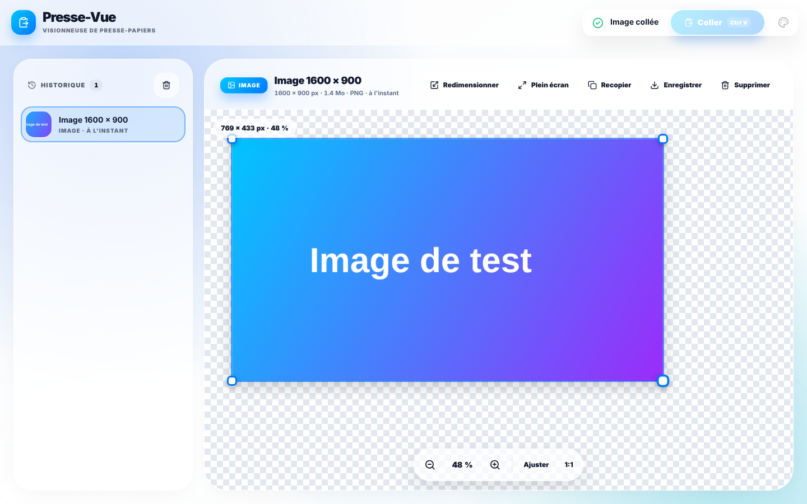

# Presse-Vue

**Collez n'importe quoi, voyez-le en grand.** Une image copiée dans Word, une capture d'écran, du texte, un fichier : appuyez sur `Ctrl + V` (ou `⌘ + V`) et Presse-Vue l'affiche immédiatement.

👉 **Essayer : https://landry160.github.io/presse-vue/**



## Pourquoi

Sous Windows, une image copiée (dans Word, un PDF, une page web) reste « coincée » dans le presse-papiers : on ne peut la voir qu'en la collant dans une application qui accepte les images. Presse-Vue est cette application — sans installation, directement dans le navigateur.

## Fonctionnalités

- **Images** : zoom fluide à la molette ou au pincement, déplacement en glissant, poignées de coin pour redimensionner, plein écran, taille réelle.
- **Redimensionner pour de vrai** : nouvelle taille en pixels (curseur, préréglages, proportions verrouillées), puis recopier, enregistrer ou ajouter à l'historique.
- **Contenu Word / web** : aperçu avec mise en forme, texte brut, code HTML, et rendu image quand Word le fournit.
- **Texte** : compteur de caractères, mots et lignes, taille du texte ajustable, JSON formaté, aperçu des couleurs (`#0078FF`).
- **Fichiers** : collez ou glissez-déposez — aperçu des vidéos, de l'audio, des PDF et des fichiers texte.
- **Historique** local des 60 derniers éléments.
- Mode clair / sombre / système, 5 thèmes de couleur, mobile et desktop.

## Raccourcis

| Touche | Action |
|---|---|
| `Ctrl + V` | Coller |
| Molette / pincement | Zoomer |
| `0` / `1` | Ajuster à l'écran / taille réelle |
| `+` / `-` | Zoomer / dézoomer |
| `F` | Plein écran |
| `R` | Redimensionner l'image |
| `↑` / `↓` | Élément précédent / suivant |
| `Échap` | Fermer la fenêtre ou quitter le plein écran |

## Confidentialité

Tout se passe dans votre navigateur. Rien n'est envoyé sur Internet : l'historique est gardé dans IndexedDB, sur votre appareil.

## Technique

- **Next.js 16** (App Router) en **export statique**, **React 19**, **TypeScript** strict, **Tailwind CSS 4** compilé au build, icônes `lucide-react`.
- La visionneuse d'image (`src/lib/viewerEngine.ts`) pilote le zoom et le déplacement hors de React, dans une boucle `requestAnimationFrame` : aucun re-rendu pendant un geste.
- Déployé automatiquement sur GitHub Pages par GitHub Actions à chaque push sur `main`.

```
src/
  app/          layout (thème sans flash), page, styles et tokens
  components/   un composant par bloc d'interface
  hooks/        useTheme
  lib/          logique pure : import du presse-papiers, images, stockage, visionneuse
source/         version d'origine en un seul fichier HTML
```

## Lancer en local

```bash
npm install
npm run dev        # http://localhost:3000
npm run build      # site statique dans out/
```

---

Fait par [Landry Tchouela](https://github.com/landry160).
